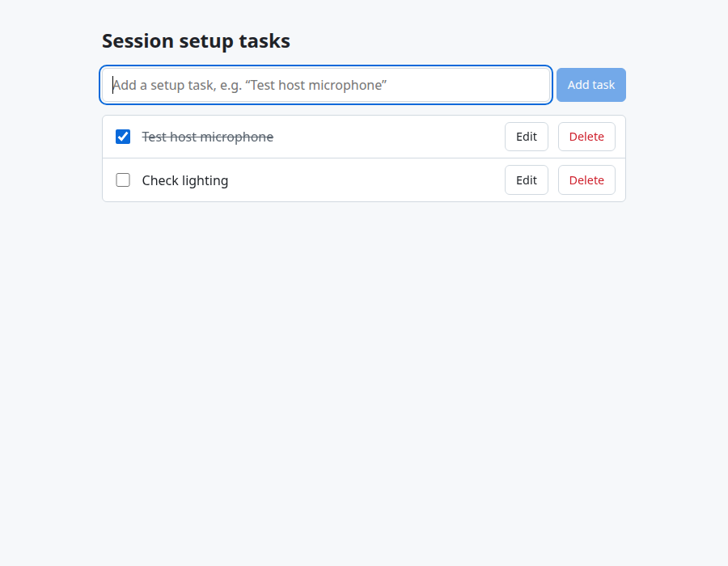

# Session Setup Tasks (POC)

Internal tool for the preparation phase of a live commerce session. Operators can add setup tasks, rename them, mark them completed (or reopen them), delete them and see the full list.

- **Backend:** Node.js + TypeScript, Fastify, SQLite (Node's built-in `node:sqlite`).
- **Frontend:** React + TypeScript (Vite), consuming the API only.



## Setup

Requires Node.js 22.13 or newer (developed on Node 24, see `.nvmrc`). No database server, Docker or `.env` file needed.

```bash
npm install
npm run dev
```

- UI: http://localhost:5173
- API docs (Swagger UI): http://localhost:3000/docs
- API: http://localhost:3000/api/v1/tasks (the Vite dev server proxies `/api` here)

Data is stored in `server/data/tasks.db` and survives restarts. Delete the file to start over.

Other commands:

```bash
npm test        # API and repository tests (Vitest)
npm run check   # format check, lint, typecheck and tests
```

Optional environment variables for the server: `PORT` (default `3000`), `HOST` (default `127.0.0.1`), `DB_PATH` (default `data/tasks.db`, relative to `server/`; `:memory:` for a throwaway database).

## API

Base path `/api/v1`, JSON only. IDs are UUIDs generated by the server; timestamps are ISO-8601 UTC. Swagger UI is generated from the same schemas that validate the requests.

```ts
Task { id: string; title: string; completed: boolean; createdAt: string; updatedAt: string }
```

| Method   | Path          | Body                                    | Success                              | Errors       |
| -------- | ------------- | --------------------------------------- | ------------------------------------ | ------------ |
| `GET`    | `/tasks`      | -                                       | `200 { data: Task[] }`, oldest first | -            |
| `POST`   | `/tasks`      | `{ title }`                             | `201 Task` + `Location` header       | `400`        |
| `GET`    | `/tasks/{id}` | -                                       | `200 Task`                           | `400`, `404` |
| `PATCH`  | `/tasks/{id}` | `{ title?, completed? }` (at least one) | `200 Task`                           | `400`, `404` |
| `DELETE` | `/tasks/{id}` | -                                       | `204`                                | `400`, `404` |

- The title is trimmed first, then it must be 1-200 characters.
- Unknown fields are rejected, and types are not coerced (`"completed": "true"` is a `400`).
- Every error has the same shape; unexpected errors are logged and return a generic message:

```json
{
  "error": {
    "code": "VALIDATION_ERROR",
    "message": "Request validation failed",
    "details": [{ "field": "body.title", "message": "must NOT have fewer than 1 characters" }]
  }
}
```

```bash
API=http://localhost:3000/api/v1/tasks
curl -i -X POST $API -H 'content-type: application/json' -d '{"title":"Test host microphone"}'
curl $API
curl -X PATCH $API/<id> -H 'content-type: application/json' -d '{"completed":true}'
curl -i -X DELETE $API/<id>
```

## Structure

The server is split into routes (HTTP only) → service (rules, timestamps, not-found) → repository (storage interface). SQLite is the real implementation; an in-memory one is used by the API tests. One `PATCH` covers both renaming and completing, and the list is wrapped in `{ data }` so pagination can be added without breaking clients. The UI only shows what the server confirmed (no optimistic updates).

## Assumptions

- A few internal operators on a trusted network, usually one at a time (as stated in the brief).
- One global task list, not yet tied to a specific live session.
- The title is the only editable field. A completed task can be reopened.
- Deletes are permanent (the UI asks for confirmation).
- Tasks are listed in creation order, like a checklist.

## Not implemented on purpose

- Authentication and authorization (out of scope per the brief).
- Tasks grouped per live session, extra fields (assignee, due date, priority), reordering.
- Pagination, filtering and search; a setup checklist has tens of items.
- Concurrency control and real-time updates between browsers.
- Frontend tests and E2E tests; testing effort went into the API.
- Serving the built UI from the API server, Docker and CI.

## What it would take to productionize

- **Access:** SSO for operators, tokens for partner integrations, roles for who can edit or delete.
- **Data:** managed Postgres with a migration tool (a new `TaskRepository` implementation), tasks scoped to a live session, audit trail and backups.
- **Concurrency:** a `version` field or ETag so conflicting edits get a `409`/`412` instead of overwriting each other; push updates (SSE/WebSocket) if several operators work together.
- **Operations:** container image, CI running `npm run check`, health/readiness endpoints, centralized logs and error tracking, security headers and rate limiting.
- **API:** pagination and filters, a frontend client generated from the OpenAPI spec.

## Risks and limitations

- **Last write wins:** two operators editing the same task will overwrite each other without warning.
- **SQLite:** a single local file with one writer, so no horizontal scaling; on an ephemeral container disk the data is lost unless `DB_PATH` points to a volume.
- **`node:sqlite`** prints an experimental warning on Node 22 and its API may still change; it is isolated behind the repository interface.
- **No auth:** anyone who can reach the server can change data. It binds to `127.0.0.1` by default for that reason.
- **Frontend types are written by hand** (`web/src/types.ts`) and can drift from the API; the server still validates every request.
